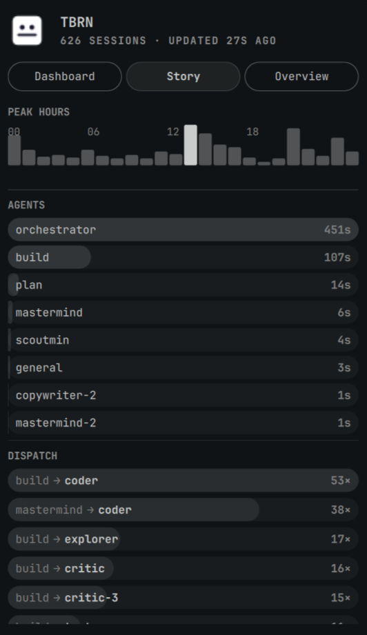
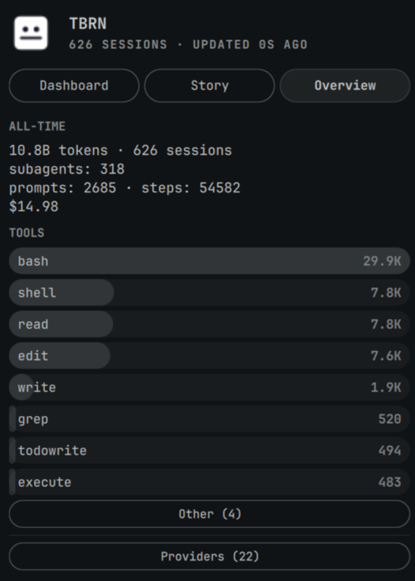

# TBRN Opencode

An Omarchy bar widget for OpenCode session stats. A robot icon sits in the bar and opens a panel with three tabs: Dashboard, Story, Overview.

A small Python collector reads your local OpenCode database, and the panel draws whatever it finds. Nothing leaves your machine.

<table>
  <tr>
    <td align="center" valign="top">
      <br>
      <sub><b>Dashboard</b></sub>
    </td>
    <td align="center" valign="top">
      <br>
      <sub><b>Story</b></sub>
    </td>
    <td align="center" valign="top">
      <br>
      <sub><b>Overview</b></sub>
    </td>
  </tr>
</table>

## The tabs

**Dashboard** shows streaks, active days, session counts, and token history. Four ranges: 7D draws a bar per day, 1M draws a bar per week, 1Y and ALL draw a GitHub-style heatmap with a Less/More legend. The model list stays collapsed until you open it.

**Story** covers how you actually work. Peak hours as a 24-bar histogram, your top-level agents, a dispatch graph of who spawned whom, and the subagents they ran.

**Overview** holds all-time totals (sessions, tokens, prompts, steps, cost), your most-used tools, and providers in collapsed rows.

## Install

```bash
omarchy plugin add https://github.com/tbrnsb/tbrn-oc-plugin.git
omarchy plugin enable tbrn.oc-plugin
omarchy-restart-shell
```

The restart matters. Bar slots do not hot-replace after install or update.

Manual install: clone the repo into `~/.config/omarchy/plugins/tbrn.oc-plugin` and run the same enable and restart commands.

## Using the panel

| Action | How |
| --- | --- |
| Open or close | Click the robot |
| Switch tabs | `←` `→`, or click a tab |
| Scroll | Mouse wheel or `↑` `↓` |
| Refresh now | `r` |
| Open a terminal | Right-click the robot |

From a script: `omarchy-shell tbrn.oc-plugin open`, `close`, `toggle`, `refresh`, `next`.

While the collector runs, the header adds "refreshing" so a slow scan never looks like a freeze. If a refresh fails, the panel keeps the last good numbers and says so. A first load with no data reads "Reading your OpenCode database…", and a database with no sessions tells you how to fill it.

## How it works

1. `collect.py` prints one JSON record. It opens the OpenCode database read-only and prefers the newer `session_v2` and `session_message` tables, falling back to `session` and `part` on older installs.
2. It also calls `opencode stats --json` for the headline numbers and caches the reply for five minutes, so the panel agrees with OpenCode's own `/statistics` page.
3. Tool counts come from a full scan of message parts. The collector caches the result and only recomputes it when the source changes, so warm refreshes take milliseconds.
4. `Main.qml` runs the collector every 15 minutes, collapses overlapping runs into one, and keeps the last good record when a run fails.
5. `Panel.qml` draws the tabs from that one record.

## Optional notifications

A companion OpenCode plugin posts a desktop notification when a subagent finishes:

```
coder has finished in 18m 12s, consuming 2.0M
```

Both files ship in `opencode/`. Copy them into place:

```bash
cp opencode/agent-finished.js ~/.config/opencode/plugins/
cp opencode/agent-finished-notify.py ~/.local/bin/
chmod +x ~/.local/bin/agent-finished-notify.py
```

OpenCode loads the JavaScript file on its next start. The script reads the session from the database, formats the summary, and calls `notify-send`. Set `AGENT_NOTIFY_ALL=1` to include top-level sessions, or `AGENT_NOTIFY=0` to turn it off.

No toast? Check that do-not-disturb is off (`omarchy-toggle-notification-silencing`) and that `notify-send test hello` shows something.

## Configuration

One setting, `refreshIntervalSec`: default 900, minimum 30, maximum 3600. Change it in Omarchy's plugin settings.

## Troubleshooting

**Panel opens empty.** Wait for the first collector run. Then check `journalctl --user -t omarchy-shell` for lines starting with `tbrn.oc-plugin:`.

**Numbers look stale.** Press `r`. If OpenCode is mid-write, `opencode stats --json` can time out; the collector falls back to its own aggregation and still returns data.

**Robot icon missing.** Restart the shell. Bar slots only mount at shell start.

**A corrupt database.** The collector opens the file read-only and never writes to it. A failed read produces empty numbers, not a crash.

## Tests

```bash
python3 -m unittest discover -s tests
```

21 tests, standard library only. They build temporary SQLite fixtures covering the V2 schema, the legacy schema, empty databases, corrupt files, missing tables, and malformed rows. They never touch your real database.

## Limitations

- Omarchy sizes the panel for its default bar. Very narrow bars clip long labels.
- The project filter dropdown is gone. `collect.py` still accepts a project id, but nothing passes one today.
- Screenshots in `assets/` capture the state at the time they were taken.

## Uninstall

```bash
omarchy plugin disable tbrn.oc-plugin
omarchy plugin remove tbrn.oc-plugin
omarchy-restart-shell
```

For a manual install, delete `~/.config/omarchy/plugins/tbrn.oc-plugin`, remove the widget from your bar config, and restart the shell. The cache under `~/.cache/tbrn.oc-plugin/` is safe to delete.

## License

MIT. See [LICENSE](LICENSE).
