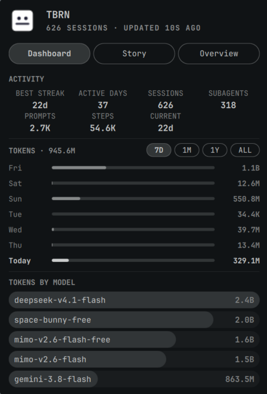

# TBRN OC Plugin

An Omarchy bar widget for OpenCode session stats. A robot icon sits in the bar and opens a three-tab panel: Dashboard, Story, Overview.

Every number comes from one read-only collector script that reads your local OpenCode database and walks the same aggregates you see in `opencode stats`.



## What the tabs show

**Dashboard** has your streaks, active days, session counts and a tokens chart with four ranges: 7D day bars, 1M week bars, 1Y and ALL as GitHub-style heatmaps, plus a collapsible tokens-per-model list.

**Story** is where your habits live: a 24-hour peak-hours histogram, your top-level agents, a dispatch graph showing who spawned whom, and the subagents they ran.

**Overview** lists all-time totals (sessions, tokens, prompts, steps, cost), your most-used tools, and providers, rolled up into collapsibles so the tab stays short.

## Install

```bash
omarchy plugin add https://github.com/tbrnsb/tbrn-oc-plugin.git
omarchy plugin enable tbrn.oc-plugin
```

Then restart the shell. Bar slots don't hot-replace:

```bash
omarchy-restart-shell
```

Manual install works the same way: clone the repo into `~/.config/omarchy/plugins/tbrn.oc-plugin` instead of using `omarchy plugin add`.

## How it works

1. `collect.py` runs and prints one JSON record. It opens OpenCode's database read-only and prefers the newer `session_v2`/`session_message` tables when they exist, falling back to the older `session`/`part` schema otherwise.
2. For headline numbers it also calls `opencode stats --json` and caches the result for five minutes, so the panel agrees with what OpenCode itself reports.
3. Tool counts need a full scan of message parts. The result is cached and only recomputed when the source changes, so warm runs take milliseconds and cold runs a few seconds.
4. `Main.qml` runs the collector every 15 minutes (configurable, 30 second minimum), coalesces overlapping runs, and keeps showing the last good record if a refresh fails.
5. `Panel.qml` renders the three tabs from that single record.

## Optional notifications

A small companion plugin shows a desktop notification when a subagent finishes:

```
coder has finished in 18m 12s, consuming 2.0M
```

It isn't installed automatically. If you want it, drop `agent-finished.js` into `~/.config/opencode/plugins/` and make sure `notify-send` works. The widget runs fine without it.

## Configuration

One setting: `refreshIntervalSec`, default 900, minimum 30, maximum 3600. Change it through Omarchy's plugin settings. The panel accepts manual refresh too: press `R` while it's open or run `omarchy-shell tbrn.oc-plugin refresh`.

## Troubleshooting

**Panel opens but shows nothing.** Wait a few seconds for the first collector run, then check `journalctl --user -t omarchy-shell` for `tbrn.oc-plugin:` lines.

**Numbers look stale.** Run `omarchy-shell tbrn.oc-plugin refresh`. If OpenCode is busy, `opencode stats --json` can time out; the collector falls back to aggregating the database itself, so you still get data.

**Missing icon after a plugin update.** Restart the shell. Again.

**Corrupt or locked database.** The collector opens the database `mode=ro` and never writes to it. If OpenCode corrupts a file that's outside this plugin's reach; the panel shows empty numbers rather than crashing.

## Tests

```bash
python3 -m unittest discover -s tests
```

21 tests, stdlib only. They build temporary SQLite fixtures (V2 schema, legacy schema, empty, corrupt, missing tables, malformed rows) and never touch your real database or the `~/.cache` state.

## Limitations

- The project filter dropdown was removed from Overview. `collect.py` still accepts a project id as an argument, but nothing in the UI passes one.
- Heatmaps and bar sizes assume Omarchy's default panel width. Very narrow bars can clip long labels.
- Screenshots live in `assets/` and reflect the state when they were captured.

## Uninstall

```bash
omarchy plugin disable tbrn.oc-plugin
omarchy plugin remove tbrn.oc-plugin
```

Manual install? Delete `~/.config/omarchy/plugins/tbrn.oc-plugin` and remove the widget from your bar config, then restart the shell. The caches under `~/.cache/tbrn.oc-plugin/` are safe to delete too.

## License

MIT, see [LICENSE](LICENSE).
