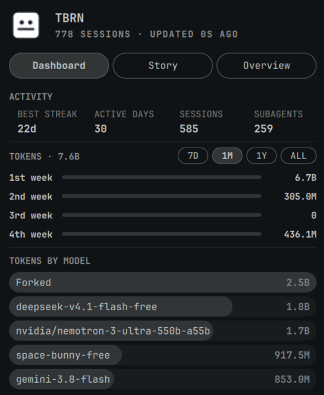

# TBRN OC Plugin

OpenCode session statistics in a native Omarchy bar panel. Shows tokens, sessions, streaks, agent/subagent breakdown, dispatch graph, peak hours, tools, and more — all matching OpenCode's own `/statistics` output exactly.



## Features

- **Stats matching OpenCode exactly** — Uses `opencode stats --json` (cached 5 min) for sessions (585), subagents (259), active days (30), best streak (22), tokens (8.4B), cost ($14.94)
- **Four time ranges** — 7D (day bars), 1M (week bars), 1Y (GitHub-style heatmap), ALL (GitHub-style heatmap)
- **Three tabs** — Dashboard (ACTIVITY + TOKENS + MODELS), Story (PEAK HOURS → DISPATCH → AGENTS → SUBAGENTS), Overview (ALL-TIME + TOOLS + PROVIDERS)
- **Project filter** — Switch between "All Projects" and individual projects (Global, etc.) to match OpenCode's project-scoped stats
- **Agent/Subagent split** — Top-level agents vs dispatched subagents with "Other (N)" dropdowns
- **Dispatch graph** — Who dispatched to whom, with counts
- **Peak hours** — 24-hour histogram with highlighted peak
- **Tools & Providers** — Collapsible dropdowns with "Other (N)"
- **Agent-finished notifications** — Desktop notification when a subagent finishes: `"<agent> has finished in <time>, consuming <tokens>"`
- **Project filter removed from Overview** — Cleaner UI

## Installation

### Via `omarchy plugin add` (recommended)

```bash
omarchy plugin add https://github.com/sulav/tbrn-oc-plugin.git
```

Then enable it:

```bash
omarchy plugin enable tbrn.oc-plugin
```

### Manual install

```bash
git clone https://github.com/sulav/tbrn-oc-plugin.git ~/.config/omarchy/plugins/tbrn.oc-plugin
omarchy-shell shell rescanPlugins
omarchy plugin enable tbrn.oc-plugin
```

## Requirements

- Omarchy with `omarchy-shell` (Quickshell-based)
- OpenCode v2.x with local stats database at `~/.local/share/opencode/opencode.db`
- Python 3 (stdlib only — no dependencies)
- `notify-send` for agent-finished notifications (optional)

## Configuration

The plugin respects the `refreshIntervalSec` setting (default 900s / 15 min). Adjust via Omarchy's plugin settings or `omarchy plugin set`.

## Notification Plugin

The `agent-finished` plugin (installed separately at `~/.config/opencode/plugins/agent-finished.js`) emits desktop notifications when a subagent finishes:

```
"coder has finished in 12m 30s, consuming 7.1M tokens"
```

## How It Works

1. **Collector** (`collect.py`) — Runs `opencode stats --json` (5-min cache) for high-level stats, reads `~/.local/share/opencode/opencode.db` READ-ONLY for detailed breakdowns (daily tokens, agents, tools, dispatch, etc.)
2. **Main.qml** — Runs collector on timer + manual refresh, exposes `record` to Panel
3. **Panel.qml** — Three-tab popup rendered from the single JSON record

## License

MIT

## Author

sulav